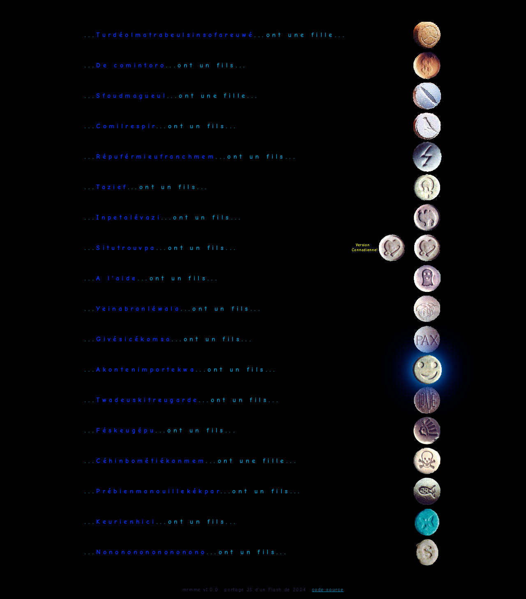

# mrmme — Monsieur et Madame… ont un fils

> Portage JS d'un vieux Flash de 2004 : 18 blagues « Monsieur et Madame », chaque cachet joue la réponse à voix haute.

**Démo : https://yrbane.github.io/MrMme/**



## Ce que c'est

L'original était un `mrmme.swf` de 2,8 Mo : une seule frame, aucun ActionScript, dix-huit lignes de texte en Comic Sans bleue sur fond noir et, à droite de chacune, un bouton rond (photo de cachet) qui joue un MP3 avec la réponse. Ce dépôt le recrée en HTML/CSS/JS sans framework ni build, avec le même contenu, les mêmes sons et le même esprit.

- Clic sur un cachet : la réponse démarre. Second clic : elle s'arrête. Un autre cachet coupe le précédent.
- La ligne « Situtrouvpa » a une « Version Cannadienne! ».
- Fonctionne au clavier, annonce les boutons aux lecteurs d'écran, s'adapte au mobile.

## Lancer en local

```bash
npm install
npm run serve      # http://localhost:4173/
```

Le site est purement statique : `index.html`, `style.css`, `src/`, `data/jokes.json` et `assets/`. Node ne sert qu'aux tests et au packaging.

## Tests

```bash
npm test           # unitaires (Vitest) puis E2E (Playwright, desktop + mobile)
npm run test:unit
npm run test:e2e
npm run shots      # régénère les captures dans shots/
```

## Décompilation

Les assets viennent de [JPEXS Free Flash Decompiler](https://github.com/jindrapetrik/jpexs-decompiler) :

```bash
java -jar ffdec.jar -cli -format shape:svg,image:png_gif_jpeg,text:formatted,sound:mp3_wav \
  -export image,text,sound,font,button,fla decompiled mrmme.swf
```

Le dossier `decompiled/` conserve les images, textes, la police et la structure (`DOMDocument.xml`, `dump.txt`) à titre de référence. Le mappage texte ↔ bouton ↔ son a été reconstruit à partir des positions de la timeline et vit dans `data/jokes.json`.

## Structure

```
index.html  style.css  src/{main,player,render}.js
data/jokes.json         18 blagues : nom, fils/fille, cachet, son, variantes
assets/pills/           photos des cachets (dimensions d'origine)
assets/sounds/          19 MP3 tels quels
tests/unit  tests/e2e   Vitest + Playwright
scripts/serve.js        serveur statique avec Range (dev + E2E)
scripts/build.js        copie le site dans dist/ pour Pages et la release
```

## Licence

Code sous licence MIT. Les sons et images proviennent du Flash d'origine et restent la propriété de leur auteur.
